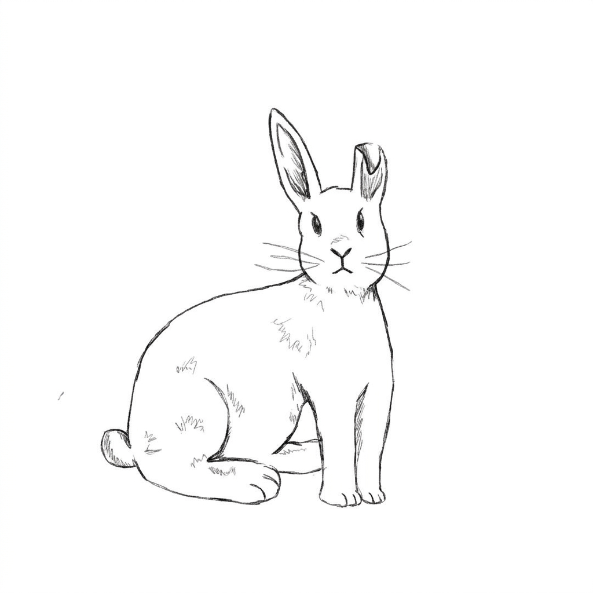

# sym

<p align="center">



A small math-oriented programming language written in C.

I'm writing this mostly because I wanted to build my own language and experiment with symbolic and numerical math.

The idea is to keep it small. No VM, no big runtime, just a compiler written in C.

### Example

```text
fn square(x: Real) -> Real = x * x;

fn main() -> Int {
    let x: Real = 12.0;
    print(square(x));
    return 0;
}
```

The syntax is still being worked on.

### Status

Very early. Right now I'm working on the token definitions. The lexer is next.

I'd like to eventually get into things like differentiation, expression simplification and numerical operations.

### Building

``` makefile
make
```

### License

BSD 2-Clause
